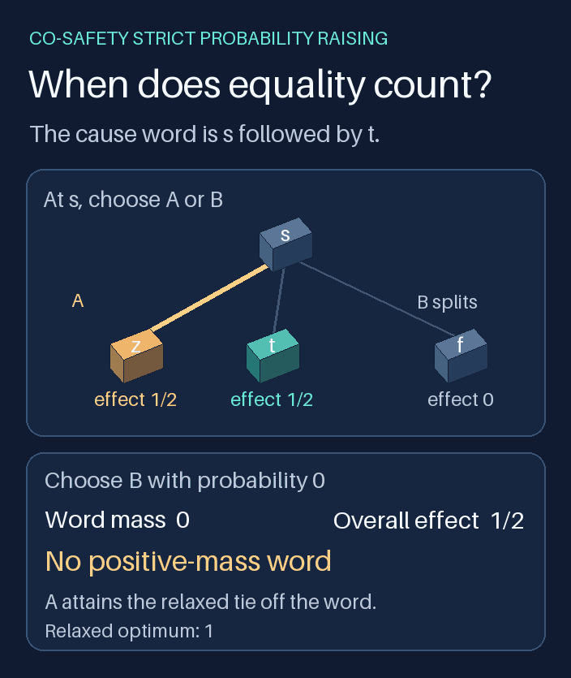

# Polynomial-time verification of co-safety strict probability-raising causes

  

Checking a supplied co-safety cause for strict probability raising is polynomial-time for an explicit finite rational Markov decision process. The cause DFA accepts exactly its minimal good prefixes and the effect is given by a deterministic Rabin automaton. Both read full states.

[Read the paper](paper/manuscript.pdf) · [LaTeX source](paper/manuscript.tex) · [Proof outline](proof/PROBLEM_AND_PROOF.md) · [Run the replay](REPRODUCIBILITY.md)

## When a tie gives a counterexample

When the off-word effect chance is 1/2, the relaxed verifier can tie by taking an action that rules out the cause word. Every scheduler with positive word mass still strictly raises the effect probability. Increasing the off-word chance to 3/4 gives a genuine tie with word mass 1/4.

[Download the offline explorer](https://raw.githubusercontent.com/DannyExperiments/cosafety-probability-raising-verification/refs/tags/v1.0.0/visualization/first-deviation-explorer.zip), extract it, and open `index.html`. Change the scheduler mixture and the off-word effect chance. [Figure guide](visualization/README.md)

## The source question

Baier, Piribauer and Ziemek give the Markov-chain check and identify the failure of a state-set reduction for this strict word-by-word test in MDPs. The proof evaluates first deviations from a word. When the relaxed value equals the threshold, it checks whether equality is attainable along positive-probability transitions.

[Exact question](https://lmcs.episciences.org/12897/pdf#page=60) · [Definition 6.11](https://lmcs.episciences.org/12897/pdf#page=57) · [Pinned Q890](https://github.com/10m-u/open-problems-catalog/blob/ca8d4d44ba3db527f19f28928c240168f545ecfe/problems/computer_science_ai/classical-statistical-machine-learning.md#q890)

[Mathematical audit](audits/public_safe_reports/MATHEMATICAL_AUDIT.md) · [Literature audit](audits/public_safe_reports/LITERATURE_AUDIT.md) · [Scope](CLAIM_SCOPE_AND_LIMITATIONS.md) · [AI disclosure](AI_DISCLOSURE.md) · [Status](STATUS.md)

[Release v1.0.0](https://github.com/DannyExperiments/cosafety-probability-raising-verification/releases/tag/v1.0.0) · [Version DOI](https://doi.org/10.5281/zenodo.24572840) · [Citation](CITATION.cff)
